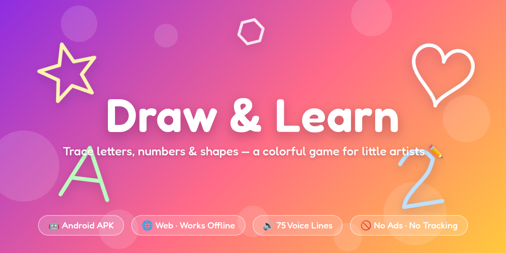
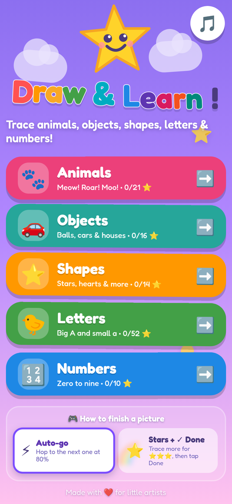
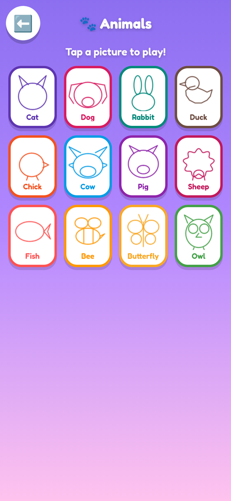
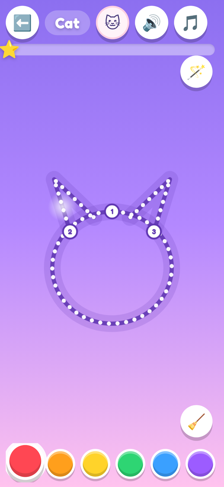
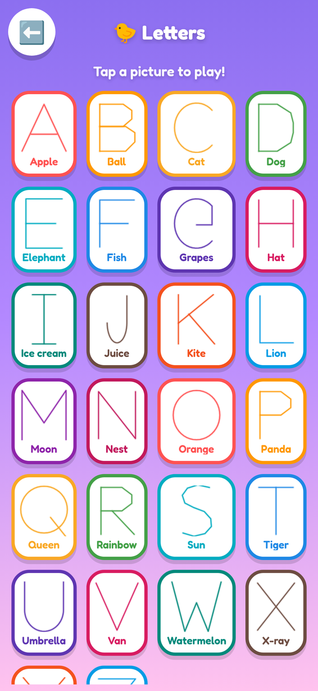
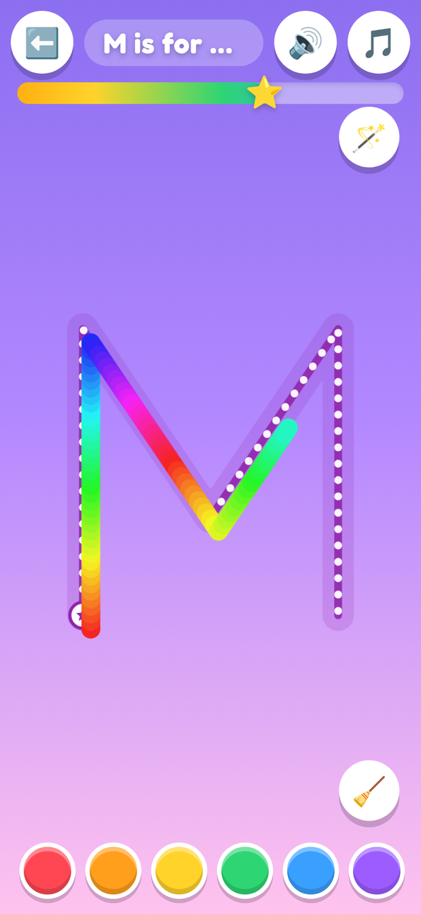
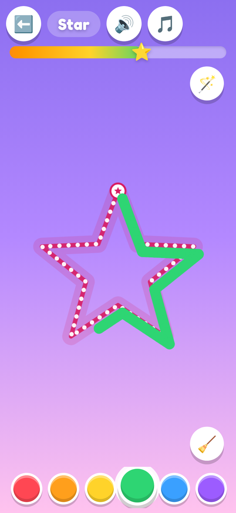
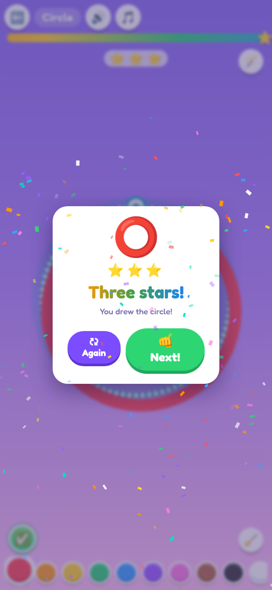
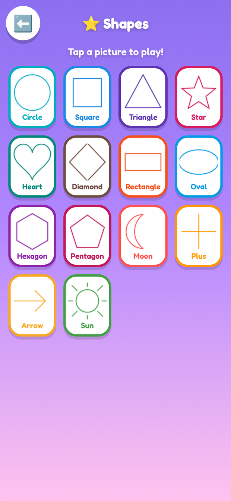

<p align="center">
  
</p>

<h1 align="center">🎨 Draw &amp; Learn</h1>

<p align="center">
  <b>A big, bright, no-rules tracing game for toddlers (ages 2–5).</b><br>
  Trace animals, letters, numbers and shapes with a fat rainbow crayon — while a friendly voice cheers them on.
</p>

<p align="center">
  <a href="https://github.com/touhidsiddiqueeraj-bit/drawinggame/releases/latest"></a>
  <a href="https://github.com/touhidsiddiqueeraj-bit/drawinggame/actions/workflows/build-apk.yml"></a>
  <a href="https://touhidsiddiqueeraj-bit.github.io/drawinggame/"></a>
  
  
  
</p>

---

## 📸 Peek inside

| | | |
|:---:|:---:|:---:|
| <br><sub><b>Pick a world</b> — animals, shapes, letters or numbers</sub> | <br><sub><b>12 animals</b> — cat, dog, cow, duck… each with its sound 🐾</sub> | <br><sub><b>What does the cat say?</b> — tap the 🐱 button: meow!</sub> |
| <br><sub><b>26 cards</b> — every letter has its word 🍎⚽🐱</sub> | <br><sub><b>Follow the dotted road</b> — rainbow crayon!</sub> | <br><sub><b>Sharp corners</b> — polygons trace like real polygons</sub> |
| <br><sub><b>Confetti!</b> — impossible to fail, always a win</sub> | <br><sub><b>14 shapes</b> — circle to star to sunshine</sub> |  |

## ✨ Made for little hands

- 🖍️ **62 things to trace** — 🐾 12 animals (cat, dog, rabbit, duck, chick, cow, pig, sheep, fish, bee, butterfly, owl), 26 capital letters (each with a word and emoji: 🍎 Apple, ⚽ Ball, 🌈 Rainbow…), the numbers 0–9, and 14 shapes from circle to star to sun.
- 🐮 **Animals that talk back** — every animal has its very own sound, synthesized live in the browser: meow, woof, moo, quack, oink, baa, buzz… It plays when the card opens, when they tap the animal button, and when they win.
- 🌈 **A fat rainbow crayon** — 11 bright colors that *speak their own name* when picked, plus a rainbow brush that cycles hues as they draw.
- 👆 **Impossible to fail** — no scores, no timers, no wrong answers. Follow the dotted road, wander off it, scribble all over — it's all fine. Cover enough of the guide (about 80%) and the confetti flies.
- 🎈 **Guides that teach themselves** — numbered start badges show stroke order, marching candy dots show the direction (letters like C, G, O are traced counter-clockwise, the way schools teach it), and a glowing hint orb demonstrates the path whenever they pause.
- 🔊 **It talks** — 87 recorded lines: the voice names every item ("M is for Moon!", "A cat! Can you draw the cat?"), cheers progress, and celebrates the win. Punchy pop / swish / sparkle sound effects, 12 animal sounds and a gentle music loop are synthesized live in the browser — one tap to mute.
- 🎉 **Celebrations!** — confetti bursts, a big "You did it!", and gold stars collected per category.
- 📴 **Works offline** — install once (APK or PWA), then it's airplane-mode friendly. No account, no ads, no tracking, no in-app purchases. Nothing to tap but the game.

## 🎮 How a toddler plays it

1. **Tap** a big picture button — 🐾 Animals, ⭐ Shapes, 🐤 Letters or 🔢 Numbers — then tap any card.
2. **Trace** the dotted road with a finger. Any color, any speed, any order.
3. **Confetti!** 🎉 A happy voice says *"You drew the star!"* — and the next card is one tap away.

## 📥 Get it

### 🤖 Android (APK)

[**⬇️ Download the latest APK**](https://github.com/touhidsiddiqueeraj-bit/drawinggame/releases/latest)
(~6 MB · Android 6.0+ · portrait · fully offline · no permissions needed)

Grab the `DrawAndLearn-*.apk` from the release, copy it to a phone (or download it right on the phone), tap it and allow "install from unknown apps" once. Every future release tag gets a fresh APK attached automatically by CI.

### 🌐 Any browser

**[▶️ Play it online](https://touhidsiddiqueeraj-bit.github.io/drawinggame/)** — or run it yourself, no build step needed:

```bash
git clone https://github.com/touhidsiddiqueeraj-bit/drawinggame.git
cd drawinggame
npx serve .        # or: python3 -m http.server 8000
```

Installed from the browser as a **PWA**, it keeps working offline.

## 🔊 The voice

All 87 lines ship as small MP3s (a cheerful child voice) so the game works offline with zero API calls, with an automatic fallback to the browser's built-in speech synthesis if a file is ever missing.

Prefer **Gemini TTS** voices? Regenerate every line with your own key:

```bash
python3 tools/generate_audio_gemini.py --key YOUR_GEMINI_API_KEY
# optional: --voice Leda|Puck|Kore   --style "warm and bubbly"
```

## 🛠️ Build it yourself

```bash
npm install
npm run www             # assemble the static site into www/
npm run android:sync    # copy web assets into the Android project
npm run android:release # → android/app/build/outputs/apk/release/app-release.apk
npm run audio:gemini    # shortcut for the Gemini TTS regenerator above
```

CI does the same on every push — `.github/workflows/build-apk.yml` builds the APK and attaches it to the release whenever you push a `v*` tag.

> Signing: the repo contains a demo keystore (`android/app/drawinggame.keystore`, password `DrawLearn2026`). Replace it with your own before publishing to a store.

## 🧠 Under the hood

- **Vanilla JS + Canvas, zero dependencies** — the whole game is a static site that loads instantly, even on old phones.
- **Corner-preserving path rendering** — tracing guides switch between soft curve smoothing and crisp line corners using a 50° turn threshold, so hearts stay round while hexagons stay pointy.
- **Forgiving tracing detection** — each guide is resampled every 5 px; the finger marks any sample within a generous radius, and 72% coverage counts as a win. Wobbly little fingers succeed.
- **All SFX + music are synthesized** with the Web Audio API — pops, swishes, fanfares and a pentatonic music loop, no audio files to download.
- **PWA** — manifest + cache-first service worker (`sw.js`; bump `CACHE_VERSION` when you ship changes).
- **Capacitor** wraps the very same static site into the Android APK — one codebase, two platforms.

## 📁 Project layout

```
index.html            the whole game — single-page app
css/style.css         candy-bright styling + animations
js/data.js            62 glyphs as stroke paths + voice manifest
js/audio.js           WebAudio SFX + animal sounds + music + voice manager
js/fx.js              sparkle / confetti particle layer
js/game.js            tracing engine (guides, brush, coverage, hints)
js/app.js             screens, palette, progress, celebration
assets/audio/         87 spoken lines (mp3)
assets/fonts/         Fredoka (SIL OFL)
tools/                www assembly + Gemini TTS regenerator
android/              Capacitor Android project
docs/                 banner + screenshots
```

## 🗺️ Ideas for next versions

- Lowercase letters & a cursive mode
- Free-draw canvas — "make your own shape!"
- More languages for the voice lines
- A tiny shape-matching mini-game

## 📝 Changelog

**v1.1.0** — *animals + smarter wins:* new 🐾 **Animals** category with 12 traceable animals, each with its own synthesized sound (meow, woof, moo, quack, oink, baa, cheep, blub, buzz, flutter, hoot, boing) — played on open, on the animal button, and at the celebration. Win threshold raised from 72% to 80% coverage so a win needs a little more of the shape. Letter-direction fix: the "magic C" family (C, G, O, Q, 0) now traces counter-clockwise from the top the way handwriting is taught — the G was reversed before.

**v1.0.1** — *shape-accuracy fix:* corner-preserving guide rendering. Rectangles, hexagons, pentagons, squares, triangles, stars and zig-zag letters (A E F H K L M N V W X Y Z…) now trace with crisp, correct corners; curvy glyphs (S, O, B, 3, hearts…) stay soft. All glyphs visually verified.

**v1.0.0** — first release: 50 traceable glyphs, 75 voice lines, 11-color rainbow crayon, confetti celebrations, offline PWA + signed Android APK.

## 💛 Credits

- [Fredoka](https://fonts.google.com/specimen/Fredoka) typeface — SIL Open Font License 1.1
- Voice clips generated with [edge-tts](https://github.com/rany2/edge-tts); a Gemini TTS regenerator is included
- Android shell by [Capacitor](https://capacitorjs.com)

## 📄 License

MIT — see [LICENSE](LICENSE). The bundled Fredoka font files remain under the SIL Open Font License 1.1.

<p align="center"><sub>Made with ❤️ for little artists.</sub></p>
