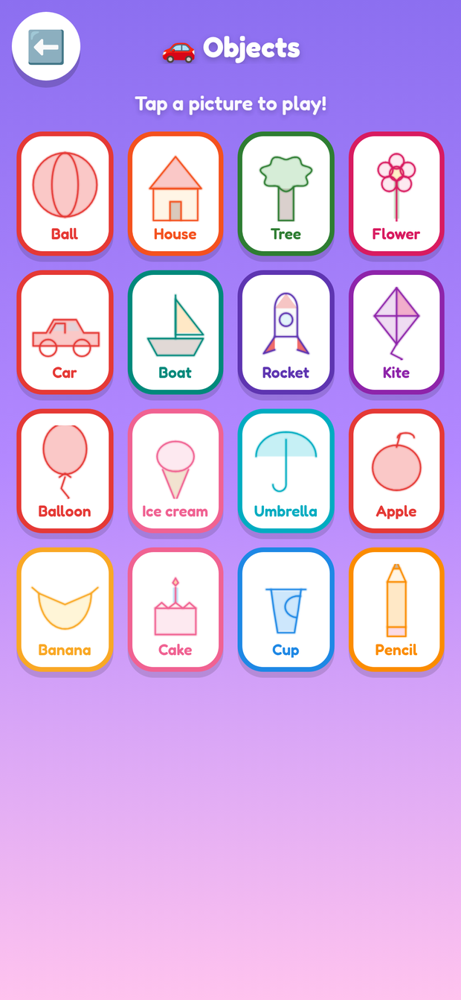
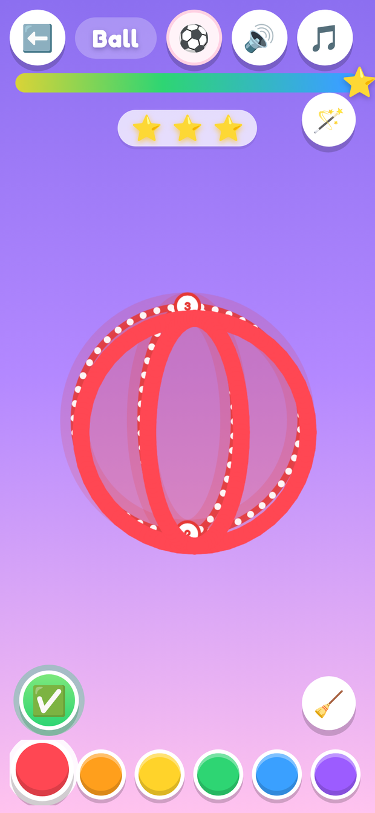

<p align="center">
  
</p>

<h1 align="center">🎨 Draw &amp; Learn</h1>

<p align="center">
  <b>A big, bright, no-rules tracing game for toddlers (ages 2–5).</b><br>
  Trace animals, objects, letters (big and small!), numbers and shapes with a fat rainbow crayon — while a friendly voice cheers them on.
</p>

<p align="center">
  <a href="https://github.com/touhidsiddiqueeraj-bit/drawinggame/releases/latest"></a>
  <a href="https://github.com/touhidsiddiqueeraj-bit/drawinggame/actions/workflows/build-apk.yml"></a>
  <a href="https://touhidsiddiqueeraj-bit.github.io/drawinggame/"></a>
  
  
  
</p>

---

## 📸 Peek inside

| | | |
|:---:|:---:|:---:|
| <br><sub><b>Pick a world</b> — animals, objects, shapes, letters or numbers</sub> | <br><sub><b>21 animals</b> — cat, lion, penguin, snail… each with its sound 🐾</sub> | <br><sub><b>Roar!</b> — trace the lion, then tap 🦁 to hear him</sub> |
| <br><sub><b>16 objects</b> — ball, house, car, rocket, kite… 🚗</sub> | <br><sub><b>Big A and small a</b> — flip the case toggle 🔡</sub> | <br><sub><b>Earn ⭐⭐⭐</b> — trace more, tap the green ✓ Done</sub> |
| <br><sub><b>Follow the dotted road</b> — rainbow crayon!</sub> | <br><sub><b>Sharp corners</b> — polygons trace like real polygons</sub> | <br><sub><b>Confetti!</b> — impossible to fail, always a win</sub> |

## ✨ Made for little hands

- 🖍️ **113 things to trace** — 🐾 **21 animals** (cat, dog, rabbit, duck, chick, cow, sheep, fish, bee, butterfly, owl, lion, elephant, monkey, penguin, frog, turtle, snail, ladybug, bear, mouse), 🚗 **16 objects** (ball, house, tree, flower, car, boat, rocket, kite, balloon, ice cream, umbrella, apple, banana, cake, cup, pencil), 🔠 **52 letters** (26 capitals *and* 26 lowercase — flip the Big/Small toggle in the picker), the numbers 0–9, and 14 shapes from circle to star to sun.
- 🔡 **Big A and small a** — the Letters picker has a case toggle; lowercase letters are drawn with proper x-height, ascenders and descenders, in the same stroke order schools teach.
- ⭐ **Two ways to pass a level** — pick on the home screen: **⚡ Auto-go** hops to the next picture at 80% (the classic flow), or **⭐ Stars + ✓ Done** lets little ones keep tracing for up to ⭐⭐⭐ (80% = 1⭐, 90% = 2⭐, 100% = 3⭐) and move on by tapping the big green ✅ button. **Stars pop into a tray at the top of the canvas while they draw** — instant rewards, no waiting — and best stars are saved per picture.
- 🎨 **Pre-colored animals with eyes** — every animal arrives softly pre-colored in its natural hue (yellow chick, brown owl, cream-wool sheep…) with cute decorative eyes and smiles, so little ones recognize the critter before they even start tracing.
- 🐮 **Animals that talk back** — every animal has its very own sound, synthesized live in the browser: meow, woof, moo, roar, trumpet, ribbit, squeak… It plays when the card opens, when they tap the animal button, and when they win. Objects get in on it too — vroom, toot, pop, splat! 🚗🎈
- 🌈 **A fat rainbow crayon** — 11 bright colors that *speak their own name* when picked, plus a rainbow brush that cycles hues as they draw.
- 👆 **Impossible to fail** — no scores, no timers, no wrong answers. Follow the dotted road, wander off it, scribble all over — it's all fine. Cover enough of the guide (about 80%) and the confetti flies.
- 🎈 **Guides that teach themselves** — numbered start badges show stroke order, marching candy dots show the direction (letters like C, G, O are traced counter-clockwise, the way schools teach it), and a glowing hint orb demonstrates the path whenever they pause.
- 🔊 **It talks** — 145 recorded lines: the voice names every item ("Big M is for Moon!", "Small a is for apple!", "A lion! Can you draw the lion?"), cheers progress, and counts the stars at the win. Punchy pop / swish / sparkle sound effects, 37 animal & object sounds and a gentle music loop are synthesized live in the browser — one tap to mute.
- 😊 **Faces with character** — eyes, smiles and ω noses are pre-drawn on every animal (smiling cat and rabbit, beaked chick, woolly sheep, tufted monkey), so each critter reads instantly at toddler-eye level.
- 🎉 **Celebrations!** — confetti bursts, a big "You did it!", gold stars collected per picture and per category.
- 📴 **Works offline** — install once (APK or PWA), then it's airplane-mode friendly. No account, no ads, no tracking, no in-app purchases. Nothing to tap but the game.

## 🎮 How a toddler plays it

1. **Tap** a big picture button — 🐾 Animals, 🚗 Objects, ⭐ Shapes, 🐤 Letters or 🔢 Numbers — then tap any card.
2. **Trace** the dotted road with a finger. Any color, any speed, any order. In 🐤 Letters, flip the **Big A / small a** toggle to switch cases.
3. **Confetti!** 🎉 A happy voice says *"You drew the star!"* — in **⚡ Auto-go** mode the next card is one tap away; in **⭐ Stars mode** the stars pop into the tray **as they trace** (80 / 90 / 100%), then they tap the green ✅ Done to move on.

## 📥 Get it

### 🤖 Android (APK)

[**⬇️ Download the latest APK**](https://github.com/touhidsiddiqueeraj-bit/drawinggame/releases/latest)
(~6 MB · Android 6.0+ · portrait · fully offline · no permissions needed)

Grab the `DrawAndLearn-*.apk` from the release, copy it to a phone (or download it right on the phone), tap it and allow "install from unknown apps" once. Every future release tag gets a fresh APK attached automatically by CI.

### 🌐 Any browser

**[▶️ Play it online](https://touhidsiddiqueeraj-bit.github.io/drawinggame/)** — or run it yourself, no build step needed:

```bash
git clone https://github.com/touhidsiddiqueeraj-bit/drawinggame.git
cd drawinggame
npx serve .        # or: python3 -m http.server 8000
```

Installed from the browser as a **PWA**, it keeps working offline.

## 🔊 The voice

All 145 lines ship as small MP3s (a cheerful child voice) so the game works offline with zero API calls, with an automatic fallback to the browser's built-in speech synthesis if a file is ever missing.

Prefer **Gemini TTS** voices? Regenerate every line with your own key:

```bash
python3 tools/generate_audio_gemini.py --key YOUR_GEMINI_API_KEY
# optional: --voice Leda|Puck|Kore   --style "warm and bubbly"
```

## 🛠️ Build it yourself

```bash
npm install
npm run www             # assemble the static site into www/
npm run android:sync    # copy web assets into the Android project
npm run android:release # → android/app/build/outputs/apk/release/app-release.apk
npm run audio:gemini    # shortcut for the Gemini TTS regenerator above
```

CI does the same on every push — `.github/workflows/build-apk.yml` builds the APK and attaches it to the release whenever you push a `v*` tag.

> Signing: the repo contains a demo keystore (`android/app/drawinggame.keystore`, password `DrawLearn2026`). Replace it with your own before publishing to a store.

## 🧠 Under the hood

- **Vanilla JS + Canvas, zero dependencies** — the whole game is a static site that loads instantly, even on old phones.
- **Corner-preserving path rendering** — tracing guides switch between soft curve smoothing and crisp line corners using a 50° turn threshold, so hearts stay round while hexagons stay pointy.
- **Forgiving tracing detection** — each guide is resampled every 5 px; the finger marks any sample within a generous radius, and 80% coverage counts as a win (or 1–3 stars in star mode). Wobbly little fingers succeed.
- **All SFX + music are synthesized** with the Web Audio API — pops, swishes, fanfares and a pentatonic music loop, no audio files to download.
- **PWA** — manifest + cache-first service worker (`sw.js`; bump `CACHE_VERSION` when you ship changes).
- **Capacitor** wraps the very same static site into the Android APK — one codebase, two platforms.

## 📁 Project layout

```
index.html            the whole game — single-page app
css/style.css         candy-bright styling + animations
js/data.js            113 glyphs as stroke paths + voice manifest
js/audio.js           WebAudio SFX + 37 animal/object sounds + music + voice manager
js/fx.js              sparkle / confetti particle layer
js/game.js            tracing engine (guides, brush, coverage, hints, auto-win flag)
js/app.js             screens, palette, progress, stars, celebration, mode setting
assets/audio/         145 spoken lines (mp3)
assets/fonts/         Fredoka (SIL OFL)
tools/                www assembly + Gemini TTS regenerator
android/              Capacitor Android project
docs/                 banner + screenshots
```

## 🗺️ Ideas for next versions

- Free-draw canvas — "make your own shape!"
- More languages for the voice lines
- A tiny shape-matching mini-game
- Cursive mode

## 📝 Changelog

**v1.2.1** — *polish pass:* 🐢 **Turtle, snail and elephant redesigned** from cartoon reference art — the turtle now has a big domed shell with scute lines and a cream rim, the snail got a huge spiral shell over a long slug body with ball-tipped eyestalks, and the elephant is a full side view with a giant fan ear, curled trunk, tusk and pillar legs. 🍌 **Banana and car redrawn** — a thick yellow crescent with a brown stem, and a classic side-view sedan with chunky wheels, hubs and a headlight. 🔡 **Lowercase letterforms fixed** — e, f, g, p, q and y redesigned to proper print shapes (a real hook on the f, a left-curling fishhook tail on the g, a rightward kick on the q, the y's v meets exactly on the baseline). 🖼️ **Thumbnail clipping fixed** — picker cards used to cut off descenders (q read as o, y as v); every thumbnail now auto-fits its whole glyph. ⭐ **Stars pop while you draw** — a 3-slot star tray at the top of the canvas fills at 80 / 90 / 100% instead of waiting for the Done tap. 🏠 The home screen footer was removed for a cleaner look.


**v1.2.0** — *the big content update:* **52 new things to trace** (113 total). 🐾 **10 new animals** — lion, elephant, monkey, penguin, frog, turtle, snail, ladybug, bear and mouse, each pre-colored with its own face and its own synthesized sound (roar, trumpet, ribbit, squeak…). 🚗 **New Objects category** — 16 everyday things from toddler first-word flashcards: ball, house, tree, flower, car, boat, rocket, kite, balloon, ice cream, umbrella, apple, banana, cake, cup and pencil — with fun sounds (vroom, toot, pop, glug…) on the sound button. 🔡 **Lowercase letters** — the Letters picker now has a **Big A / small a toggle**; all 26 lowercase letters are drawn with proper x-height, ascenders and descenders. ⭐ **Toggleable pass mode** on the home screen: keep classic **⚡ Auto-go at 80%**, or switch to **⭐ Stars + ✓ Done** — trace past 80% for more stars (1⭐ / 2⭐ / 3⭐ at 80 / 90 / 100%), then tap the big green ✅ button to move on; best stars are saved per picture and shown on the cards. Voice lines grew to 145 ("Big A is for Apple!", "Small a is for apple!", "You earned two stars!"…).

**v1.1.2** — *smiling faces + a cuter sheep:* the **sheep was redesigned** as a chibi head-only cutie — fluffy scalloped wool sitting like a hat on a big soft face, leaf ears, round eyes and little ω nose marks (classic clipart look). The **chick got a proper front-facing face** (orange diamond beak right between the eyes, rosy cheeks, symmetric wings), and the **bee's face zone moved up** — eyes, smile and cheeks sit clearly above the stripes. The **cat and rabbit are smiling now** (pink triangle nose + ω / curved smile), and every smile renders in the picker thumbnails too.

**v1.1.1** — *recognizable animals:* every animal now arrives **pre-colored in its natural hue** (yellow chick, brown owl, pink rabbit, cream-wool sheep…) with **cute decorative eyes**, so toddlers recognize each critter before tracing. Chick, sheep and owl redesigned from scratch; cow rebuilt with a wide face, top horns and leaf ears; bee got a proper face zone above its stripes. The pig was removed. Everything verified in a 4-round visual review — 11/11 animals recognizable.

**v1.1.0** — *animals + smarter wins:* new 🐾 **Animals** category with traceable animals, each with its own synthesized sound (meow, woof, moo, quack, baa, cheep, blub, buzz, flutter, hoot, boing) — played on open, on the animal button, and at the celebration. Win threshold raised from 72% to 80% coverage so a win needs a little more of the shape. Letter-direction fix: the "magic C" family (C, G, O, Q, 0) now traces counter-clockwise from the top the way handwriting is taught — the G was reversed before.

**v1.0.1** — *shape-accuracy fix:* corner-preserving guide rendering. Rectangles, hexagons, pentagons, squares, triangles, stars and zig-zag letters (A E F H K L M N V W X Y Z…) now trace with crisp, correct corners; curvy glyphs (S, O, B, 3, hearts…) stay soft. All glyphs visually verified.

**v1.0.0** — first release: 50 traceable glyphs, 75 voice lines, 11-color rainbow crayon, confetti celebrations, offline PWA + signed Android APK.

## 💛 Credits

- [Fredoka](https://fonts.google.com/specimen/Fredoka) typeface — SIL Open Font License 1.1
- Voice clips generated with [edge-tts](https://github.com/rany2/edge-tts); a Gemini TTS regenerator is included
- Android shell by [Capacitor](https://capacitorjs.com)

## 📄 License

MIT — see [LICENSE](LICENSE). The bundled Fredoka font files remain under the SIL Open Font License 1.1.

<p align="center"><sub>Made with ❤️ for little artists.</sub></p>
